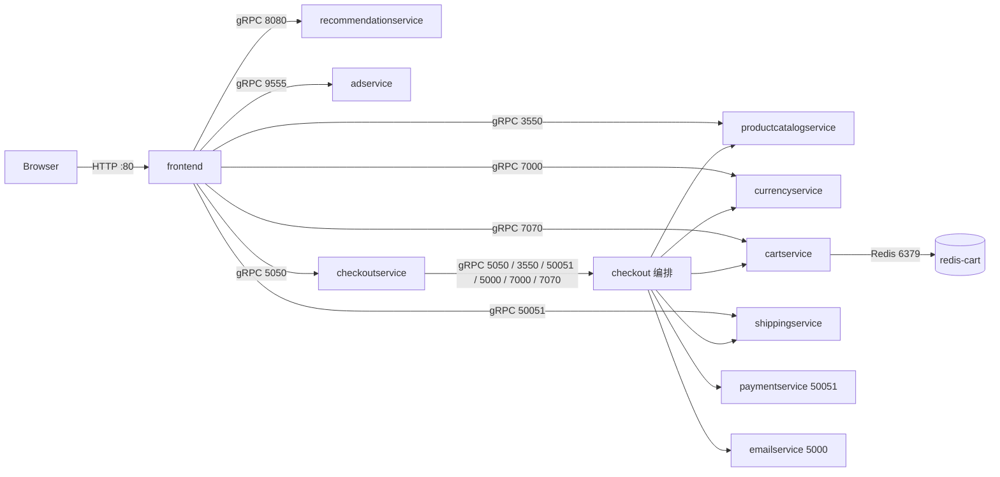
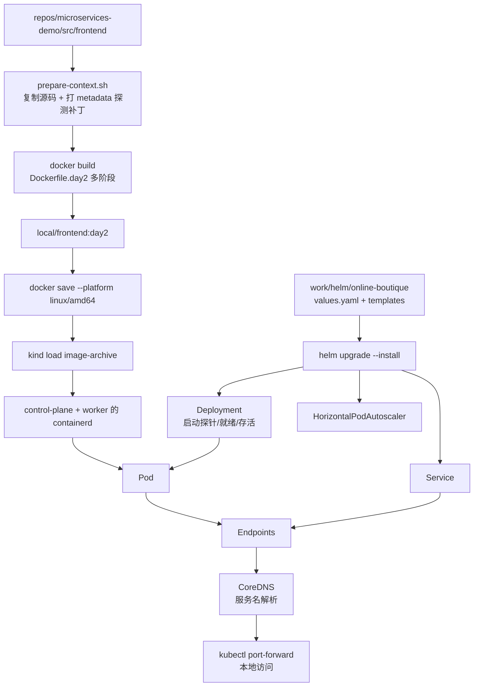
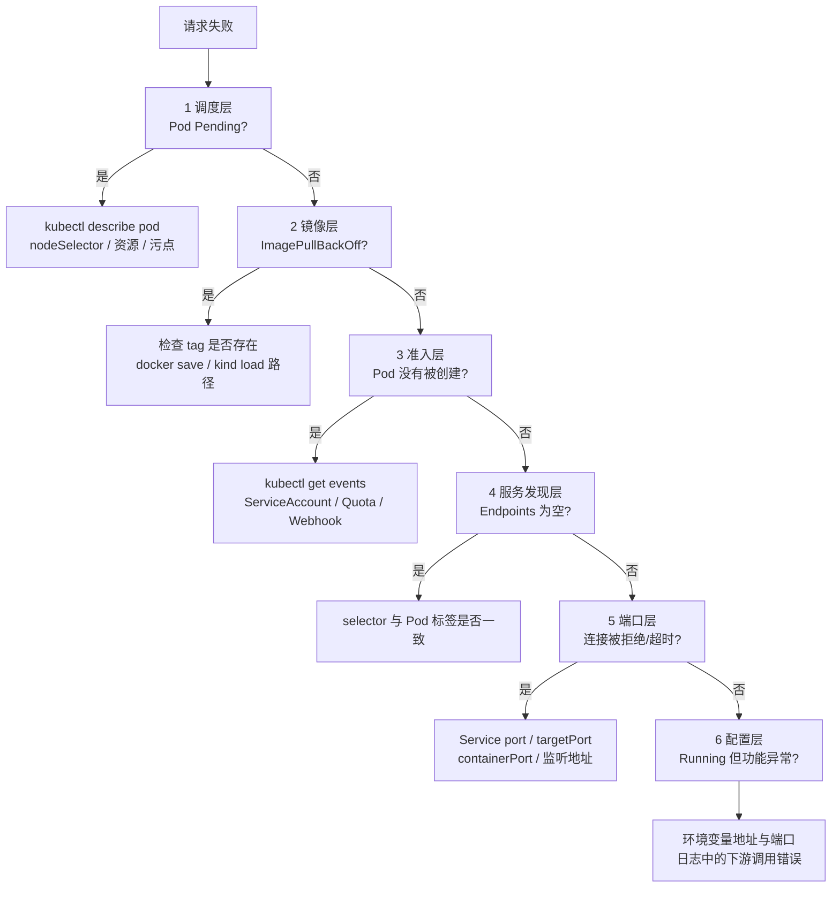

# 架构与排障路径

本项目是 Online Boutique（11 个微服务）在单机 Kind 集群上的 POC。
本文回答三个问题：**业务怎么调用、镜像怎么进集群、出问题按什么顺序查**。

- 集群：`qa-cluster`（Kind v0.33.0，Kubernetes v1.32.2，control-plane + worker）
- 命名空间：`qa-helm`（Helm release `online-boutique`）
- 入口：`kubectl port-forward -n qa-helm svc/frontend 8081:80`

## 1. 业务调用链

关键点：

- 只有 frontend 暴露 HTTP；其余服务都是集群内 gRPC。
- checkoutservice 是编排者：一次下单会串行/并行调用支付、邮件、物流、购物车、商品、货币六个服务，因此它是下单链路最脆弱的一环。
- cartservice 的有状态依赖只有 redis-cart；当前 POC 用 `emptyDir`，节点/Pod 重建会丢购物车。

## 2. 部署链路

关键点：

- `repos/` 是上游源码，不修改；所有定制（补丁、Dockerfile、Chart、脚本）都在 `work/`。
- Docker 29 的 containerd 镜像存储必须用 `docker save --platform linux/amd64`，否则 kind 导入报 `content digest not found`（见 RCA-7）。
- `kind load` 不会覆盖节点上已存在的同名 tag；重建镜像后需要 `kubectl rollout restart`。
- HPA 开启时 Deployment 不设置 `replicas`，副本数由 HPA 管理；metrics-server 在 Kind 下必须加 `--kubelet-insecure-tls`。

## 3. 排障六层

从外到内，逐层排除；每层先看状态，再看 Events，最后看日志。

| 层 | 典型症状 | 第一命令 | 本项目案例 |
|---|---|---|---|
| 调度 | Pod Pending | `kubectl describe pod` | RCA-2 nodeSelector |
| 镜像 | ImagePullBackOff | `kubectl describe pod` | RCA-1 tag 不存在 |
| 准入 | Deployment 无 Pod | `kubectl get events` | RCA-3 ServiceAccount |
| 服务发现 | Service 无 Endpoints | `kubectl get endpoints` | RCA-4 selector 拼写 |
| 端口 | 连接拒绝/超时 | `kubectl get svc -o yaml` | RCA-5 targetPort |
| 配置 | Running 但业务 500 | `kubectl logs` + 环境变量 | RCA-6 货币端口 |

补充：**Pod Running 不等于服务可用**。必须同时满足 Readiness 通过、Endpoints 非空、真实请求成功。
完整案例见 `work/reports/rca.md`。
