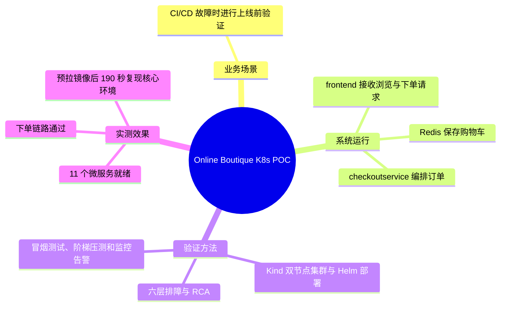

# Online Boutique Kubernetes POC 项目全景

## 一、一句话定位

在本地 Kind 多节点集群上部署 Google Online Boutique 的 11 个微服务，通过分层排障修复部署与应用故障，验证完整下单链路和系统稳定性，并产出可复现的 RCA 文档与 Helm 交付物。

---

## 二、项目整体逻辑

项目分为三层，每一层解决不同的问题：

```
┌────────────────────────────────────────────────────┐
│ 业务层：Online Boutique 电商系统（11 个微服务）      │
│ 浏览商品 → 加入购物车 → 填写支付 → 下单              │
├────────────────────────────────────────────────────┤
│ 平台层：Docker + Kind + Kubernetes                  │
│ 容器运行、调度、服务发现、健康检查、资源管理          │
├────────────────────────────────────────────────────┤
│ 交付层：Helm + 压测 + RCA + 演示材料                 │
│ 可复现、可参数化、可量化、可讲解                      │
└────────────────────────────────────────────────────┘
```

- **业务层**回答“这个系统是干什么的”。
- **平台层**回答“它跑在哪、怎么被管理”。
- **交付层**回答“怎么证明它能用、怎么交给别人”。

---

## 三、系统怎么运作

### 3.1 业务调用链

用户从浏览器访问 frontend，frontend 再调用其他微服务：

```
浏览器
  │
  ▼
frontend（Go，HTTP 入口）
  ├── productcatalogservice   商品列表与详情
  ├── currencyservice         汇率与价格换算
  ├── cartservice ──► redis-cart   购物车
  ├── recommendationservice ──► productcatalogservice   推荐
  ├── adservice               广告
  ├── shippingservice         运费
  └── checkoutservice         下单编排
        ├── cartservice        读取购物车
        ├── productcatalogservice  校验商品与价格
        ├── currencyservice    换算币种
        ├── shippingservice    计算运费
        ├── paymentservice     扣款
        └── emailservice       发送订单确认
```

### 3.2 一次下单的完整过程

1. 用户打开首页，frontend 调用 productcatalog 获取商品、currency 获取汇率、ad 获取广告、recommendation 获取推荐。
2. 用户加入购物车，frontend 调用 cartservice，cartservice 把数据写入 redis-cart。
3. 用户点击下单，frontend 调用 checkoutservice。
4. checkoutservice 依次完成：读取购物车、校验商品、换算币种、计算运费、调用 payment 扣款、调用 shipping 发货、清空购物车、调用 email 发送确认。
5. 任意一步失败，整个下单请求失败，并把错误返回给 frontend。

这条链路是排障的核心：**哪个功能失败，就沿着这条链找对应的那一跳。**

### 3.3 部署与运行链路

```
镜像仓库 gcr.io
    │ docker pull
    ▼
宿主机 Docker 镜像
    │ kind load docker-image
    ▼
Kind 节点 containerd
    │ kubectl apply
    ▼
API Server → etcd
    │
    ▼
Deployment 控制器 → ReplicaSet → Pod
    │
    ▼
Scheduler 选择节点 → kubelet → containerd 启动容器
    │
    ▼
readiness 通过 → Endpoints 加入 Pod IP
    │
    ▼
Service（ClusterIP）→ kube-proxy 转发 → 容器端口
    │
    ▼
CoreDNS 提供服务名解析
```

理解这条链路，就能理解为什么 Pod Running 不等于服务可用：**Running 只说明容器在跑，Endpoints 才说明它被纳入了 Service 的后端。**

### 3.4 排障链路

项目按 Pod 生命周期分为六层：

| 层 | 失败表现 | 典型原因 | 排查入口 |
|---|---|---|---|
| 调度 | Pending | nodeSelector 无匹配节点、资源不足 | `describe pod` 的 Events |
| 镜像 | ImagePullBackOff | 镜像名或 tag 不存在、仓库权限 | `describe pod` 的 Failed to pull |
| 准入 | Pod 根本不存在 | ServiceAccount 不存在、配额限制 | `describe rs/deploy` 的 Events |
| 服务发现 | Pod Running 但调用失败 | Service selector 与 Pod label 不匹配 | `get endpoints` 为空 |
| 端口 | connection refused | targetPort 与容器监听端口不一致 | 对比 Service 与容器端口 |
| 配置 | 特定功能异常 | 环境变量中的地址或端口错误 | `logs` 与应用配置 |

项目里的 6 个故障正好分布在这六层，形成一套完整的排障样本。

---

## 四、业务场景

组织的 CI/CD 流水线故障，最新版本无法按正常流程发布。上线前必须先在测试环境验证：资源是否达到期望状态、服务之间是否连通、用户能否完成下单、系统在压力下是否稳定。验证通过后，才能推动到生产环境，并提交每个问题的根因分析。

---

## 五、解决了什么问题

1. **缺少可复现的预发布验证环境**：本地 Kind 集群一条命令重建，避免“我机器上能跑”。
2. **故障定位依赖猜测**：建立六层排障法，每层都有明确的命令和判断标准。
3. **交付物不可复用**：用 Helm 把 11 个服务模板化，换环境只改 values。
4. **演示缺少量化证据**：用 loadgenerator 压测，输出失败率、RPS、P95。
5. **知识无法传递**：输出 RCA、架构图、复现步骤。

---

## 六、用了什么方法

| 方法 | 作用 |
|---|---|
| Kind 双节点集群 | 本地模拟多节点调度，支持 nodeSelector 类故障 |
| 官方镜像 + `kind load` | 避免公网依赖，加快 Pod 启动 |
| 基线部署再修复 | 先记录故障现象，再逐条修复，形成可复现的排障过程 |
| 六层排障法 | 调度 → 镜像 → 准入 → 服务发现 → 端口 → 配置 |
| kubectl 五件套 | `get` / `describe` / `logs` / `get events` / `exec` |
| Endpoints 验证 | 判断 Service 是否真正有可用后端 |
| Helm | 模板化、参数化、版本回滚 |
| loadgenerator | 量化稳定性 |
| RCA 文档 | 沉淀根因和修复过程 |
| 多阶段构建（可选） | 减小镜像体积，理解镜像分层 |

---

## 七、效果

| 指标 | 实测值（证据） |
|---|---|
| Pod 状态 | 11/11 Running 1/1，重启数 0（`work/logs/day6-final-*.log`） |
| Deployment | 11/11 达到期望副本 |
| 下单链路 | 浏览 → 加购 → 支付 → 下单成功（`smoke-test.sh`，Day 5/6 均通过） |
| 压测（Day 2） | 10 并发 / 5 分钟 / 0% 失败 / P95 85 ms（自建镜像） |
| 阶梯压测（Day 3） | 20/50/100 并发、每档 3 分钟；RPS 27.43/55.22/66.84；失败率 0/0.161%/0.242%；P95 1.0/1.4/2.2 s |
| 弹性 | frontend HPA 1→4 约 93 秒，4→1 约 3.5 分钟 |
| 可观测 | kube-prometheus-stack；Grafana 压测截图；3 条告警规则，PodCrashLooping 已验证触发/恢复 |
| 故障覆盖 | 8 条 RCA（6 类清单故障 + kind 镜像导入 + 探针/OOM） |
| 复现时间 | 删集群后 190 秒（3 分 10 秒）；镜像已预拉，不含监控栈 |
| 本机 CI | `make ci` 通过（`SMOKE OK` / `VERIFY OK`） |
| 自建镜像 | frontend 52.8 MB（官方 55.9 MB） |
| 交付物 | Helm Chart、RCA、架构图、压测/复现报告、截图 |

---


## 八、思维导图


