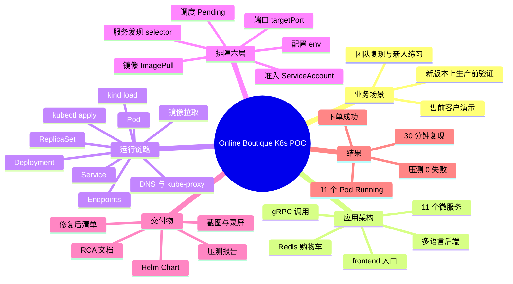

# Online Boutique Kubernetes POC 项目全景（简历版）

> **状态（2026-11-01）**：Day 0–6 已完成，Day 7 缓冲/加分项未做。
> 本文所有效果数字均来自 `work/logs/` 与 `work/reports/` 的真实输出；
> 未执行的项目（GitHub Actions 远端运行、演示视频、模拟面试）已明确标注，不得写成已完成。
> 简历只能写已经发生且有证据的事实。

---

## 一、一句话定位

在本地 Kind 多节点集群上部署 Google Online Boutique 的 11 个微服务，通过分层排障修复部署与应用故障，验证完整下单链路和系统稳定性，并产出可复现的 RCA 文档与 Helm 交付物。

它不是“开发了一个电商系统”，而是“把一个现成的微服务系统完整地部署、排障、验证并交付”。

---

## 二、项目整体逻辑

项目分为三层，每一层解决不同的问题：

```
┌────────────────────────────────────────────────────┐
│ 业务层：Online Boutique 电商系统（11 个微服务）      │
│ 浏览商品 → 加入购物车 → 填写支付 → 下单              │
├────────────────────────────────────────────────────┤
│ 平台层：Docker + Kind + Kubernetes                  │
│ 容器运行、调度、服务发现、健康检查、资源管理          │
├────────────────────────────────────────────────────┤
│ 交付层：Helm + 压测 + RCA + 演示材料                 │
│ 可复现、可参数化、可量化、可讲解                      │
└────────────────────────────────────────────────────┘
```

- **业务层**回答“这个系统是干什么的”。
- **平台层**回答“它跑在哪、怎么被管理”。
- **交付层**回答“怎么证明它能用、怎么交给别人”。

简历里最容易犯的错误，是把三层混在一起写，导致面试官不知道你到底做了什么。

---

## 三、系统怎么运作

### 3.1 业务调用链

用户从浏览器访问 frontend，frontend 再调用其他微服务：

```
浏览器
  │
  ▼
frontend（Go，HTTP 入口）
  ├── productcatalogservice   商品列表与详情
  ├── currencyservice         汇率与价格换算
  ├── cartservice ──► redis-cart   购物车
  ├── recommendationservice ──► productcatalogservice   推荐
  ├── adservice               广告
  ├── shippingservice         运费
  └── checkoutservice         下单编排
        ├── cartservice        读取购物车
        ├── productcatalogservice  校验商品与价格
        ├── currencyservice    换算币种
        ├── shippingservice    计算运费
        ├── paymentservice     扣款
        └── emailservice       发送订单确认
```

### 3.2 一次下单的完整过程

1. 用户打开首页，frontend 调用 productcatalog 获取商品、currency 获取汇率、ad 获取广告、recommendation 获取推荐。
2. 用户加入购物车，frontend 调用 cartservice，cartservice 把数据写入 redis-cart。
3. 用户点击下单，frontend 调用 checkoutservice。
4. checkoutservice 依次完成：读取购物车、校验商品、换算币种、计算运费、调用 payment 扣款、调用 shipping 发货、清空购物车、调用 email 发送确认。
5. 任意一步失败，整个下单请求失败，并把错误返回给 frontend。

这条链路是排障的核心：**哪个功能失败，就沿着这条链找对应的那一跳。**

### 3.3 部署与运行链路

```
镜像仓库 gcr.io
    │ docker pull
    ▼
宿主机 Docker 镜像
    │ kind load docker-image
    ▼
Kind 节点 containerd
    │ kubectl apply
    ▼
API Server → etcd
    │
    ▼
Deployment 控制器 → ReplicaSet → Pod
    │
    ▼
Scheduler 选择节点 → kubelet → containerd 启动容器
    │
    ▼
readiness 通过 → Endpoints 加入 Pod IP
    │
    ▼
Service（ClusterIP）→ kube-proxy 转发 → 容器端口
    │
    ▼
CoreDNS 提供服务名解析
```

理解这条链路，就能理解为什么 Pod Running 不等于服务可用：**Running 只说明容器在跑，Endpoints 才说明它被纳入了 Service 的后端。**

### 3.4 排障链路

项目按 Pod 生命周期分为六层：

| 层 | 失败表现 | 典型原因 | 排查入口 |
|---|---|---|---|
| 调度 | Pending | nodeSelector 无匹配节点、资源不足 | `describe pod` 的 Events |
| 镜像 | ImagePullBackOff | 镜像名或 tag 不存在、仓库权限 | `describe pod` 的 Failed to pull |
| 准入 | Pod 根本不存在 | ServiceAccount 不存在、配额限制 | `describe rs/deploy` 的 Events |
| 服务发现 | Pod Running 但调用失败 | Service selector 与 Pod label 不匹配 | `get endpoints` 为空 |
| 端口 | connection refused | targetPort 与容器监听端口不一致 | 对比 Service 与容器端口 |
| 配置 | 特定功能异常 | 环境变量中的地址或端口错误 | `logs` 与应用配置 |

项目里的 6 个故障正好分布在这六层，形成一套完整的排障样本。

---

## 四、业务场景

### 4.1 原始场景

组织的 CI/CD 流水线故障，最新版本无法按正常流程发布。上线前必须先在测试环境验证：资源是否达到期望状态、服务之间是否连通、用户能否完成下单、系统在压力下是否稳定。验证通过后，才能推动到生产环境，并提交每个问题的根因分析。

### 4.2 包装后的场景

把它做成一套**售前 POC 环境**：

- 在客户现场，用一台笔记本在 30 分钟内拉起完整电商系统。
- 演示“部署 → 暴露故障 → 分层定位 → 修复 → 压测验证”的完整闭环。
- 用 RCA 文档证明团队具备生产环境的排障能力。
- 同时可作为团队新人的 Kubernetes 练习环境和版本回归环境。

### 4.3 面向的用户

| 用户 | 关心什么 |
|---|---|
| 售前工程师（直接使用者） | 能否快速演示、稳定复现 |
| 客户技术决策者 | 团队是否具备生产落地与排障能力 |
| 面试官 | 你的排障思路和工程判断 |
| 团队新人 | 能否照着文档独立复现 |
| 终端消费者 | 能否正常浏览、加购、下单 |

---

## 五、解决了什么问题

1. **缺少可复现的预发布验证环境**：本地 Kind 集群一条命令重建，避免“我机器上能跑”。
2. **故障定位依赖猜测**：建立六层排障法，每层都有明确的命令和判断标准。
3. **交付物不可复用**：用 Helm 把 11 个服务模板化，换环境只改 values。
4. **演示缺少量化证据**：用 loadgenerator 压测，输出失败率、RPS、P95。
5. **知识无法传递**：输出 RCA、架构图、复现步骤和演示录屏。

---

## 六、用了什么方法

| 方法 | 作用 |
|---|---|
| Kind 双节点集群 | 本地模拟多节点调度，支持 nodeSelector 类故障 |
| 官方镜像 + `kind load` | 避免公网依赖，加快 Pod 启动 |
| 基线部署再修复 | 先记录故障现象，再逐条修复，形成可复现的排障过程 |
| 六层排障法 | 调度 → 镜像 → 准入 → 服务发现 → 端口 → 配置 |
| kubectl 五件套 | `get` / `describe` / `logs` / `get events` / `exec` |
| Endpoints 验证 | 判断 Service 是否真正有可用后端 |
| Helm | 模板化、参数化、版本回滚 |
| loadgenerator | 量化稳定性 |
| RCA 文档 | 沉淀根因和修复过程 |
| 多阶段构建（可选） | 减小镜像体积，理解镜像分层 |

---

## 七、效果（完成后可写的口径）

| 指标 | 实测值（证据） |
|---|---|
| Pod 状态 | 11/11 Running 1/1，重启数 0（`work/logs/day6-final-*.log`） |
| Deployment | 11/11 达到期望副本 |
| 下单链路 | 浏览 → 加购 → 支付 → 下单成功（`smoke-test.sh`，Day 5/6 均通过） |
| 压测（Day 2） | 10 并发 / 5 分钟 / 0% 失败 / P95 85 ms（自建镜像） |
| 阶梯压测（Day 3） | 20/50/100 并发、每档 3 分钟；RPS 27.43/55.22/66.84；失败率 0/0.161%/0.242%；P95 1.0/1.4/2.2 s |
| 弹性 | frontend HPA 1→4 约 93 秒，4→1 约 3.5 分钟 |
| 可观测 | kube-prometheus-stack；Grafana 压测截图；3 条告警规则，PodCrashLooping 已验证触发/恢复 |
| 故障覆盖 | 8 条 RCA（6 类清单故障 + kind 镜像导入 + 探针/OOM） |
| 复现时间 | 删集群后 190 秒（3 分 10 秒）；镜像已预拉，不含监控栈 |
| 本机 CI | `make ci` 通过（`SMOKE OK` / `VERIFY OK`） |
| 自建镜像 | frontend 52.8 MB（官方 55.9 MB） |
| 交付物 | Helm Chart、RCA、架构图、压测/复现报告、截图、演示脚本 |
| 未执行 | GitHub Actions 远端运行、演示视频、模拟面试 |

再次强调：**只写已经跑出来、能在 `work/logs/` 找到出处的数字。**

---

## 八、简历写法

### 8.1 项目名称

> Online Boutique 微服务 Kubernetes 部署与故障排查实践

或面向售前：

> 基于 Kind 的微服务 POC 环境建设与交付

### 8.2 DevOps / Kubernetes 岗版本

> - 基于 Kind 搭建双节点 Kubernetes 集群，完成 Online Boutique **11 个微服务**的部署，覆盖 Deployment、Service、Namespace、ServiceAccount 等核心资源。
> - 建立“调度 → 镜像 → 准入 → 服务发现 → 端口 → 配置”六层排障方法，定位并修复 **6 类故障**（镜像 tag 不存在、nodeSelector 无匹配节点、ServiceAccount 缺失、Service selector 拼写错误、targetPort 不一致、服务地址端口错误），输出完整 RCA 文档。
> - 使用 Helm 将全部服务模板化，实现参数化部署与版本回滚；通过 loadgenerator 完成 **20/50/100 并发阶梯压测**（每档 3 分钟），RPS 27.4/55.2/66.8，失败率 ≤0.24%，P95 1.0–2.2 秒；frontend HPA 从 1 扩到 4 约 93 秒。
> - 基于多阶段构建自建 frontend 镜像，体积由 55.9 MB 降至 52.8 MB，并通过 `kind load` 完成本地镜像替换验证。
> - 用 Shell + Makefile 固化 build / deploy / smoke / verify 流程，本机 `make ci` 通过；删除集群后 **190 秒**从零复现 11 个微服务并完成真实下单。
> - 基于 kube-prometheus-stack 搭建监控，配置 3 条 PrometheusRule，验证 PodCrashLooping 告警 Pending → Firing → 恢复。

### 8.3 售前 / 解决方案岗版本

> - 面向客户 POC 场景，搭建可在 **30 分钟内复现**的本地 Kubernetes 电商演示环境，覆盖 11 个微服务与完整下单链路。
> - 设计“基线部署 → 故障暴露 → 分层定位 → 修复 → 压测验证”的演示脚本，将排障过程转化为可讲解的客户价值。
> - 输出架构图、RCA 文档、压测报告与演示录屏，支撑技术方案汇报与客户答疑。

### 8.4 STAR 口述版

**S（背景）**：新版本需要上生产，但 CI/CD 流程故障，缺少一个可复现的环境来验证应用是否就绪。

**T（任务）**：在本地 Kubernetes 集群部署 11 个微服务，定位所有阻碍上线的故障，验证下单链路和稳定性，并产出可交付的文档。

**A（行动）**：用 Kind 搭建双节点集群；先按原始清单部署并记录基线；按调度、镜像、准入、服务发现、端口、配置六层逐层排查；每修一个问题就复测；最后用 Helm 模板化并用 loadgenerator 压测。

**R（结果）**：11 个 Pod 全部 Running，下单链路打通；20/50/100 并发阶梯压测的失败率 ≤0.24%，50 用户 / 55 RPS 为容量拐点，P95 1.4 秒；形成 8 条 RCA、3 条告警规则，以及一套删集群后 190 秒可复现的环境。

### 8.5 不要写的内容

- 不要写“设计并开发了 11 个微服务”。应用是 Google 开源的，你做的是部署、排障和交付。
- 不要写没有实际跑出来的数字。
- 不要把未执行的 GitHub Actions 远端运行、演示视频、模拟面试写成已完成。
- 不要写“生产级高可用”。这是本地单机集群，没有多可用区、没有外部 LB。
- 不要写“优化了系统性能”。除非你真的做了调优并有前后对比数据。

---

## 九、思维导图

### 9.1 Mermaid 版本



### 9.2 文本版本（不支持 Mermaid 时使用）

```
Online Boutique K8s POC
├── 业务场景
│   ├── 新版本上生产前验证
│   ├── 售前客户演示
│   └── 团队复现与新人练习
├── 应用架构
│   ├── 11 个微服务
│   ├── frontend 入口
│   ├── 多语言后端
│   ├── gRPC 调用
│   └── Redis 购物车
├── 运行链路
│   ├── 镜像拉取
│   ├── kind load
│   ├── kubectl apply
│   ├── Deployment → ReplicaSet → Pod
│   ├── Service → Endpoints
│   └── DNS 与 kube-proxy
├── 排障六层
│   ├── 调度 Pending
│   ├── 镜像 ImagePull
│   ├── 准入 ServiceAccount
│   ├── 服务发现 selector
│   ├── 端口 targetPort
│   └── 配置 env
├── 交付物
│   ├── RCA 文档
│   ├── 修复后清单
│   ├── Helm Chart
│   ├── 压测报告
│   └── 截图与录屏
└── 结果
    ├── 11 个 Pod Running
    ├── 下单成功
    ├── 压测 0 失败
    └── 30 分钟复现
```

---

## 十、面试时的 30 秒版本

> 这个项目是把 Google 的 11 微服务电商系统部署到本地 Kind 集群上，模拟一次“新版本上生产前必须先验证”的场景。我先按原始清单部署，记录基线，然后按调度、镜像、准入、服务发现、端口、配置六层逐层排查，修掉了 6 类故障，最后用 Helm 做模板化、用 loadgenerator 做压测。结果是 11 个 Pod 全部 Running，下单链路打通，压测失败率为 0，并且形成了一套 30 分钟就能复现的环境和一份逐条 RCA。

如果面试官只给 10 秒：

> 我在本地 K8s 集群部署了 11 个微服务，建立了一套六层排障方法，修复 6 类故障并输出 RCA，最终打通下单链路并完成压测验证。
